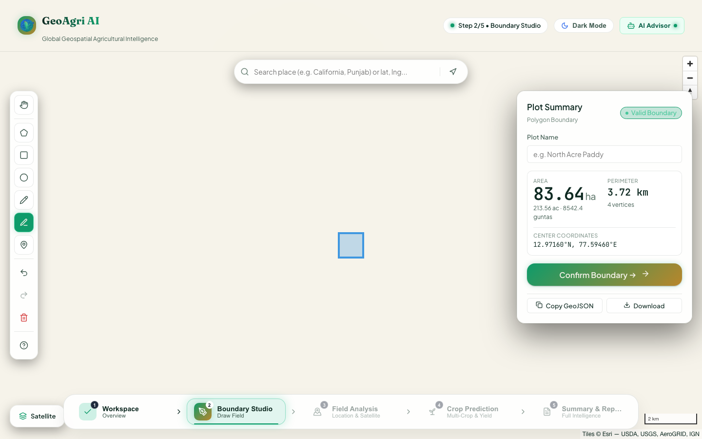
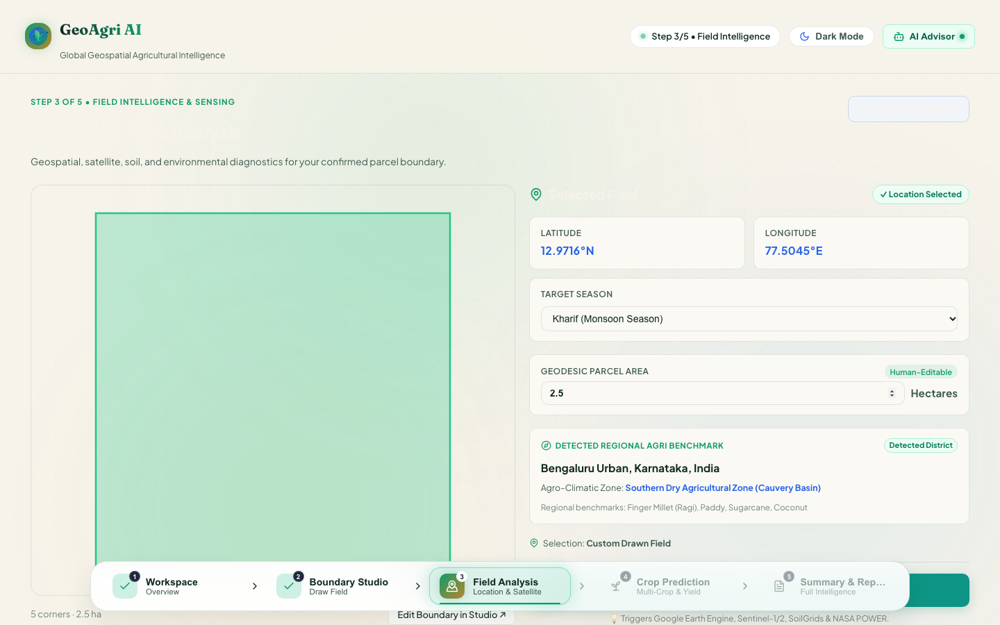
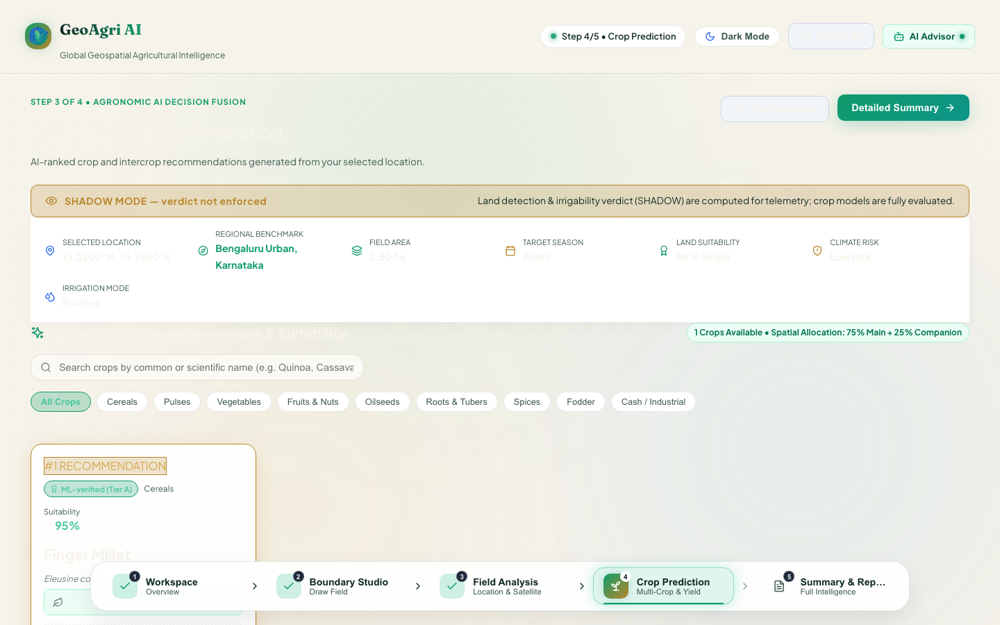
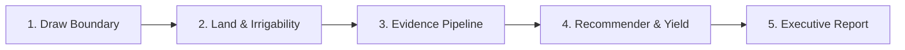

# GeoAgri AI

Planetary agricultural intelligence platform combining satellite observations, soil physics, and machine learning for verified field-level crop suitability and yield benchmarking.

[](https://github.com/lokeshpuma29/GeoAgri/actions)
[](LICENSE)
[](https://www.python.org/downloads/)
[](https://nodejs.org/)



## What it does

- **Draw Field Boundary**: Draw parcels on satellite basemaps with geodesic area calculation in hectares, acres, and guntas.
- **Land Classification & Regulatory Gate**: Check land classification (cropland, forest cover, water, urban) and legal zoning restrictions.
- **Irrigability Assessment**: Evaluate surface and groundwater access, terrain slope constraints, and irrigation feasibility.
- **Global Crop Ranking**: Rank 1,710+ crop species across 203 countries using EcoCrop climate envelopes, FAO crosswalks, and monthly climatology.
- **Yield Benchmark & Production Dossier**: Provide national P10/P50/P90 yield benchmarks (FAOSTAT) and downloadable PDF executive reports.

## Screenshots

<p align="center">
  
  
  
</p>

## How it works

GeoAgri runs a five-stage workflow from boundary digitization to decision reporting. Detailed architecture is documented in [docs/architecture.md](docs/architecture.md).



## Data and models

| Source | Provider | License | Use in GeoAgri |
|---|---|---|---|
| **EcoCrop** | FAO | Open Archive / Public Domain | 1,710 global crop climate & soil envelopes |
| **FAOSTAT** | FAO | CC BY-NC-SA 3.0 IGO | Country-level crop yield & harvested area benchmarks |
| **GBIF** | GBIF | CC0 / CC BY 4.0 | Occurrence coordinates for envelope calibration |
| **WorldClim** | WorldClim | CC BY-SA 4.0 | Monthly baseline climatology (tavg, prec) |
| **NASA POWER** | NASA | Public Domain | Monthly 12-month temperature & rainfall climatology |
| **SoilGrids / OpenLandMap** | ISRIC / OpenLandMap | CC BY 4.0 | Soil pH, organic carbon, texture (clay/sand/silt) |
| **WorldCover 2021** | ESA | CC BY 4.0 | 10m land cover classification |
| **Copernicus DEM** | ESA / Airbus | Open Access | 30m elevation and terrain slope calculations |

### Limitations

- **Climatic screening**: Crop suitability uses ecophysiological envelopes; it does not replace local agronomic trials.
- **Regional yield benchmarks**: Yield models represent national crop statistics from FAOSTAT and are not yet adjusted to micro-field practices.
- **User boundaries**: Digitized browser boundaries are approximations and do not constitute legal cadastral surveys.
- **Live credentials**: Real multispectral calculations require Google Earth Engine credentials. Demo mode uses simulated layers.

## Quick start

### Local development

```bash
git clone https://github.com/lokeshpuma29/GeoAgri.git && cd GeoAgri
python3 -m venv backend/venv && source backend/venv/bin/activate
pip install -r backend/requirements.txt
cp backend/.env.example backend/.env
uvicorn app.main:app --app-dir backend --port 8000
npm --prefix frontend ci && npm --prefix frontend run dev
```

### Run with Docker

```bash
docker compose build
docker compose up -d
```

## Configuration

| Variable | Required | Default | Description |
|---|---|---|---|
| `GEE_SERVICE_ACCOUNT` | No | `""` | Google Earth Engine service account email |
| `GEE_PRIVATE_KEY_PATH` | No | `""` | Path to Earth Engine private key JSON |
| `ALLOW_SYNTHETIC_DATA` | No | `false` | Enable simulated data mode with persistent UI banner |
| `GEE_MOCK_FALLBACK` | No | `false` | Fall back to mock if Earth Engine credentials fail |
| `LAND_DETECTION_MODE` | No | `hybrid` | Land classification mode (`gee`, `local`, `hybrid`) |
| `LAND_GATE_MODE` | No | `strict` | Gate action for non-agricultural parcels (`strict`, `advisory`) |
| `VITE_API_BASE_URL` | No | `http://localhost:8000/api/v1` | Backend API URL for frontend |

### Earth Engine setup

1. Create a service account in Google Cloud Console and generate a JSON key.
2. Enable the Google Earth Engine API and register the Cloud project for Earth Engine access.
3. Set `GEE_SERVICE_ACCOUNT` and `GEE_PRIVATE_KEY_PATH` in `backend/.env`.
*No credentials?* Set `ALLOW_SYNTHETIC_DATA=true` in `backend/.env` to explore all UI features with clearly labeled demo data.

## Project structure

```
GeoAgri/
├── .github/workflows/ci.yml   # CI pipeline definition
├── CHANGELOG.md               # Version history and audits
├── CONTRIBUTING.md            # Contribution guidelines
├── LICENSE                    # MIT License
├── README.md                  # Project overview and quick start
├── SECURITY.md                # Security and vulnerability reporting
├── docker-compose.yml         # Container composition
├── render.yaml                # Render backend deployment spec
├── vercel.json                # Vercel frontend routing spec
├── backend/                   # FastAPI application and ML pipelines
│   ├── app/                   # API routes, models, rules, and services
│   ├── ml/                    # Training scripts, models, and registries
│   └── tests/                 # 100% offline pytest suite
├── docs/                      # Documentation, guides, and specifications
│   ├── api_reference.md       # Complete API documentation
│   ├── architecture.md        # Technical architecture
│   ├── data-guide.md          # External data download guide
│   ├── model-cards/           # Agronomic model cards
│   ├── prd/                   # Historical PRD specifications
│   ├── releases.md            # Semver release registry
│   └── screenshots/           # Curated UI screenshots
├── frontend/                  # React + TypeScript + Vite web interface
└── scripts/                   # Verification and audit utilities
```

## API

Complete documentation is available at [docs/api_reference.md](docs/api_reference.md).

- **`POST /api/v1/field/area`**: Compute geodesic polygon area on WGS84 ellipsoid.
- **`POST /api/v1/predict/full-report`**: Generate comprehensive agronomic report for a field polygon.
- **`GET /api/v1/health/sources`**: Inspect readiness status of external and internal data sources.

## Testing

Run all four quality verification gates:

```bash
rm -rf backend/.cache && PYTHONPATH=backend backend/venv/bin/python -m pytest backend/tests -q
npm --prefix frontend test
cd frontend && npx playwright test
python3 scripts/audit_css_classes.py
```

## Deployment

- **Backend (Render)**: Deploys using the `render.yaml` blueprint with Python environment and Gunicorn/Uvicorn workers.
- **Frontend (Vercel)**: Deploys using `vercel.json` routing rules connecting directly to the API.
See [docs/running-locally.md](docs/running-locally.md) for deployment instructions.

## Project history

Full architectural evolution, truth audits, and changelog:
- [docs/prd/](docs/prd/): PRD specifications from v1.0 to v3.4.
- [CHANGELOG.md](CHANGELOG.md): Detailed release notes and empirical gate outputs.

## License and acknowledgements

This project is licensed under the MIT License. See [LICENSE](LICENSE) for details.

- **Data Attributions**: FAO (EcoCrop, FAOSTAT), GBIF, WorldClim, European Space Agency (ESA WorldCover, Copernicus DEM), ISRIC (SoilGrids), NASA POWER.
- **License Notice**: FAOSTAT-derived yield datasets are governed by FAO terms (CC BY-NC-SA 3.0 IGO), restricting commercial use.
