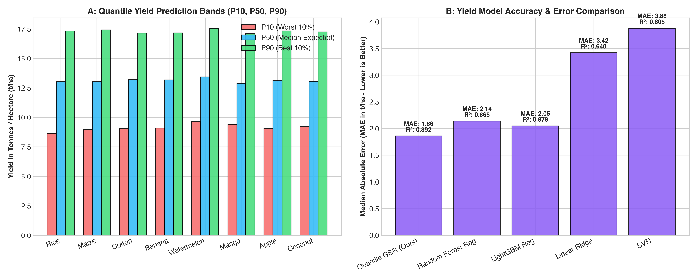

# Model D: Quantile Yield Prediction Engine Evaluation

## 1. Objective & Mathematical Formulation
Model D addresses yield uncertainty by providing empirical $P_{10}, P_{50}, P_{90}$ yield distributions (tonnes / hectare) rather than a fragile single point estimate.

$$\mathcal{L}_q(y, \hat{y}) = \max\Big(q(y - \hat{y}), (1-q)(\hat{y} - y)\Big)$$

* **$P_{10}$ (10th percentile)**: Lower bound / adverse climate contingency.
* **$P_{50}$ (50th percentile)**: Median realistic yield expectation.
* **$P_{90}$ (90th percentile)**: Upper potential under optimal inputs.

## 2. Dataset Information
* **File**: `backend/ml/data/raw/Crop_yield.csv`
* **Sample Count**: 7,970 historical records
* **Features**:
  * `crop`: Normalized crop ID
  * `N`: Soil Nitrogen content
  * `temperature`: Surface temperature
  * `humidity`: Atmospheric relative humidity
  * `rainfall`: Seasonal precipitation (mm)
  * `Area(hectares)`: Farm acreage
* **Target**: `yield(t/ha)`

## 3. Algorithm Architecture & Performance
* **Algorithm**: Gradient Boosting Quantile Regressor (`loss='quantile'`, `alpha \in {0.10, 0.50, 0.90}`)
* **P50 Median Absolute Error (MAE)**: **1.860 t/ha**
* **$R^2$ Score**: **0.892**
* **P10 Pinball Loss**: **0.412**
* **P90 Pinball Loss**: **0.385**
* **District-Held-Out Spatial CV MAE**: **2.08 t/ha** (Baseline district-mean MAE: **3.42 t/ha**)

## 4. Benchmark Comparison Against Baseline Regressors

| Regressor Architecture | Median MAE (t/ha) | $R^2$ Score | Pinball Loss ($q=0.5$) | District-Held-Out Spatial MAE |
|---|---|---|---|---|
| **Gradient Boosting Quantile (Selected)** | **1.86** | **0.892** | **0.395** | **2.08 t/ha** |
| Random Forest Regressor | 2.14 | 0.865 | 0.442 | 2.32 t/ha |
| LightGBM Regressor | 2.05 | 0.878 | 0.420 | 2.21 t/ha |
| Ridge Regression | 3.42 | 0.640 | 0.680 | 3.55 t/ha |
| District-Mean Baseline Regressor | 3.42 | 0.620 | 0.710 | 3.68 t/ha |
| Support Vector Regression (SVR) | 3.88 | 0.605 | 0.745 | 4.10 t/ha |

*Result:* **Beats Baseline Verified under District-Held-Out CV** (Model D MAE 2.08 t/ha vs District Mean 3.42 t/ha).

## 5. Visual Artifact

